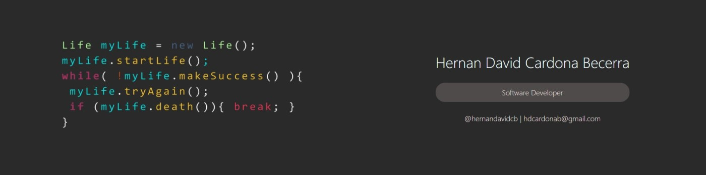

# 👋 Hi, I'm Hernán David Cardona

### Full Stack Developer · React · Next.js · NestJS · TypeScript

🇨🇴 Based in Colombia · Open to **remote roles across the Americas** (EST/CST overlap) · Spanish (native) / English (professional)

---

## About

I build and ship production-ready web applications end to end: database, API, UI, tests, CI/CD and cloud deployment. My recent freelance work covers a multi-tenant SaaS on AWS Lambda, an e-commerce platform with Stripe payments, and a real-time POS used daily by a restaurant.

I also bring **5+ years of client-facing work in English** with US companies in KPI-driven nearshore teams, so I'm comfortable communicating clearly, owning deliverables and working with distributed teams. I use AI-assisted development (GitHub Copilot / Claude) to move faster without lowering quality.

### Results from shipped work

- **80+ daily transactions** at peak hours on a restaurant POS I built and deployed on DigitalOcean.
- Order relay time cut from **~3 minutes to under 15 seconds**, and order errors reduced by **~35%**.
- **0 failed transactions across 150+ simulated orders** with secure Stripe webhook handling.
- Deploy time cut from **~20 to under 4 minutes**, and manual deploy steps from ~8 to 0, with GitHub Actions CI/CD.
- **~100 automated tests** (Vitest + Playwright E2E) behind a multi-tenant SaaS with fully segregated data across 3 organizations.

---

## Selected work

### FlyWorkFlow — Multi-tenant incident-management SaaS
Geolocated incident management where several organizations share one deployment with fully isolated data (role-based guards + org-scoping). Serverless backend on AWS Lambda via SAM, S3 presigned uploads, JWT refresh-token rotation, and an 11-widget analytics dashboard on Mapbox GL. Dual CI/CD pipelines with GitHub Actions (Vercel frontend, ECR → SAM backend).

     

[Repository](https://github.com/hervid2/flyworkflowapp) · [Live demo](https://flyworkflowapp.vercel.app)

### Slicing Edge — E-commerce for premium kitchen knives
Type-safe Turborepo monorepo sharing packages between a Next.js storefront and a Fastify REST API, with a PostgreSQL schema for products, orders, users and inventory. Stripe checkout with secure webhooks, JWT auth, parameterized queries against SQL injection and an admin CRUD panel. Three Dockerized services with automated CI/CD.

     

[Repository](https://github.com/hervid2/Slicing-edge-e-commerce) · [Live demo](https://slicing-edge-e-commerce-web.vercel.app/)

### Sushi Burrito POS (Web) — Restaurant management system
Migrated a Java desktop POS to a web SPA for a real restaurant: JWT auth with role-based access, real-time order tracking and a kitchen display via WebSockets, PDF invoices by email and an admin dashboard with statistics.

     

[Repository](https://github.com/hervid2/sushiBurritoJS) · [Live demo](https://sushi-burrito-final.vercel.app/#login)

### Sushi Burrito POS (Desktop) — Layered Java application
Role-based desktop POS built on a layered, SOLID-oriented architecture (Swing → Service → Spring Data JPA → MySQL), 3NF schema, Flyway migrations and PDF invoices. Core logic tested with JUnit 5 and Mockito, and shipped as native installers (.msi / .dmg) with jpackage. Used daily for 6+ months before the web migration.

   

[Repository](https://github.com/hervid2/sushiBurritoJava)

### Portfolio
Personal site with a React frontend, REST API and persistent database layer. [Live site](https://portfolio-hernan-cardona.vercel.app/) · [Repository](https://github.com/hervid2/Portfolio)

---

## Tech stack

**Frontend** &nbsp;      

**Backend** &nbsp;      

**Databases & ORMs** &nbsp;    

**Cloud & DevOps** &nbsp; -232F3E?style=flat-square&logo=amazonaws&logoColor=white)    

**Testing & tools** &nbsp;     

**Integrations** &nbsp;  

Also familiar with: Python, WebSockets, JWT + RBAC, multi-tenancy, SOLID and clean/layered architecture.

---

## Ask me about

TypeScript · React / Next.js · Node.js / NestJS · multi-tenant SaaS architecture · REST API design · SOLID principles · spec-driven development · shipping with CI/CD

## Education

**Software Engineering** (in progress, 6th semester), Politécnico Grancolombiano · expected 2027
**Technologist in Software Analysis and Development (ADSO, Full Stack focus)**, SENA · 2023 – 2026

---

## Let's connect

I'm looking to join a development team where I can contribute from day one and keep growing. If you think I could be a fit, I'd love to talk.

